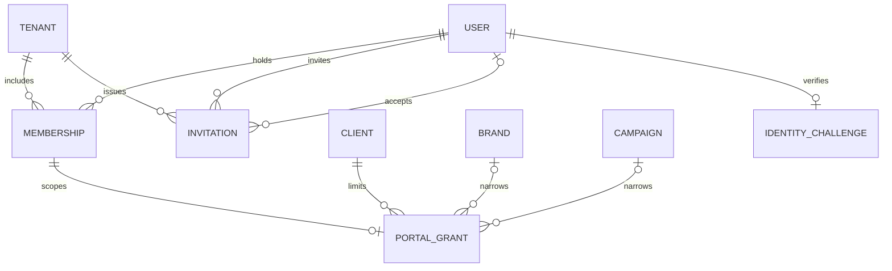

# Account lifecycle and invitation-first onboarding

Internal development, synthetic mail only. PR #15 merged at ece8ecc84b4938900821ff85403bb5b8243534c6 after review of cc0e980c. [Post-merge CI](https://github.com/datnv41001/ai-company/actions/runs/45363202327).

## Journeys and state

Previously registration reserved an organization and verification created its first owner. Clients needed an account before an agency could invite them. The web registration now creates an individual account. Verification leads to a workspace picker or an empty state. A verified user may create an organization explicitly or accept a named invitation. A client joining an agency obtains just the offered client scope. Existing callers that send an organization name keep their original registration contract.

| Entity | Transitions |
| --- | --- |
| Account | Registered → verified. Either state can have zero memberships. Existing memberships survive upgrade. |
| Invitation | Pending → accepted or revoked. Expiry is computed from the stored deadline. Resend replaces the pending offer atomically with a new ID, deadline and secret. Terminal offers remain historical. |
| Membership | Absent → owner on explicit creation, or absent → stored role on acceptance. Repeated acceptance cannot add another grant or acceptance event. Membership scope and removal retain their existing handlers. |

## Storage and upgrade

A user has many memberships across tenants. A tenant has many invitations addressed to an email. A pending invitation may precede its recipient user. Acceptance binds the matching user and creates that user's membership, optional client grant and audit in the same transaction. Composite brand/campaign foreign keys continue to constrain scope. v19 allows a null invitation user, adds a nullable unique link digest and enforces one pending offer per tenant and normalized email. Historical invitations have no link and remain accessible in the verified inbox. Preserve historical migration files. Snapshot the v18 database with its signer's secret, test restoring it to a separate database, compare identity, grant, registry, ledger and snapshot rows. Stop writes and reconcile new users, memberships and decisions before switching back to that restore and its v18 binary.

The composite scope keys relate these records as follows.

Separate account and workspace creation through an optional organization name on the existing endpoint. This preserves old callers and avoids shadow accounts for unregistered recipients. The explicit workspace request UUID is scoped to the actor and maps to a stable workspace ID. The same transaction creates its owner and initial in-house client. Retrying the request reads the existing workspace.

## API, UI and permission matrix

| Actor | Operation | Outcome |
| --- | --- | --- |
| Visitor | POST /api/auth/register with email/password | Account only. An explicit legacy organization name reserves its workspace for verification. |
| Verified account | POST /api/me/workspaces with name, mode and a request UUID | One owner workspace per actor/request. Retrying with conflicting parameters returns 409. |
| Verified owner/admin | POST tenant invitations or POST invitations/{id}/resend | Freeze server-validated terms. Deliver a seven-day link to the addressed synthetic mailbox. Only owners may invite admins. |
| Signed-in verified recipient | POST /api/me/invitation-link with the secret | Read the addressed terms. Wrong account, expired, consumed or revoked links get a generic unavailable result. |
| Signed-in verified recipient | POST /api/me/invitation-link/accept, or accept a visible invitation through the inbox | Explicit consent. The same locked grant operation revalidates issuer authority for both paths. |
| Anonymous/unverified | Open link | Offer registration/login or verification. Opening the page never grants access. |

The URL uses a fragment, removed from browser history on entry and retained only in page memory. The client sends the secret in a POST body. A wrong-account screen offers switching accounts. A verified account can see its pending invitations, create a workspace and switch existing memberships. Both the desktop and mobile acceptance views show stored rights before the action.

## Threat model and operational boundaries

A bare runtime database login cannot mint a verified actor proof. A valid end-user session can exercise its own signed transaction but cannot choose another actor or use a preceding transaction's signature. Context restoration after commit restores identifiers only. Identity challenges are sensitive even within an authenticated database transaction. Binding challenge issuance and redemption to purpose, digest, actor and transaction prevents a general actor signature or a readable database digest from authorizing either operation. The API signs redemption only after comparing the submitted private code. API compromise or loss of the signing key compromises this boundary. Restrict the publisher, worker, mailbox and process secret independently.

Invitation links use 32 random bytes. Store only their purpose-prefixed SHA-256 digest. Separate invitation deliveries from verification-code files. Both use a private local transport. Write before commit so a delivery failure rolls back. A link left by a failed commit has no active row. Recipient identity comes from the verified user. Store all offered fields on the invitation. Serialize replacement, revocation and acceptance on the invitation row. Never echo link secrets in API responses, redirects, validation errors, screenshots or logs. Issuers can already see their own workspace membership roster. Issue the same response for registered and unregistered non-members. Existing registration conflicts, password timing, bulk sending and per-IP/per-recipient quotas require abuse controls before external use. Workload RLS outside identity and worker impersonation require a separate cross-service review.

## Acceptance and follow-up

ONB-T01–02 check account-only verification and idempotent explicit creation. T03–09 cover unregistered address, bind after verification, wrong account, expiry, revoke, concurrent accepts, issuer changes and immutable terms. T10–12 exercise zero/multiple memberships and the client portal at 1280/390. T13 replaces a link. T14–15 upgrade a populated v18 and rehearse restoring the previous snapshot. Re-run SQLite/PostgreSQL, Chromium, full migration history and Qwen on head and integration. Commercial GA remains NO-GO.

| Tests | Executable evidence |
| --- | --- |
| T01, T02 | `test_account_only_and_idempotent_workspace` |
| T03–T05, T07, T09, T12, T13 | `test_invitation_before_account_resend_and_consent`, verified identity race tests |
| T06, T08 | `test_withdrawn_and_expired_links_keep_workspace_private`, `test_issuer_demotion_serializes_with_accept` |
| T10, T11 | `test_multiple_workspaces_pending_and_cross_tenant_resend`, Chromium invitation-first cases |
| T14, T15 | `tests/check_postgres_upgrade.py --from-v18`, marker failure, independent archive restoration and comparison |
| Signed DB transaction | `test_verified_actor_and_email_challenge_have_separate_authority` |

In the v18 rollback rehearsal the archive also contains pending identity challenges and the protected signing key. Restrict operator access to the archive. CI compares the restored data across 15 tables without printing its contents. A v19 binary verifies the complete migration history on startup. Use the CI workflow for the disposable database environment and the project-specific Compose instructions in HANDOFF.md for a new development machine.

Separate increments: (1) rate limits and invitation quotas, (2) session inventory, refresh, logout and revocation, (3) recovery, MFA and signer rotation, (4) team lifecycle and ownership transfer, (5) transactional email outbox, delivery retries and suppression, (6) OIDC/SSO and a database/worker identity audit. Evaluate managed Auth0 or self-hosted Keycloak for established account/session factors against operating cost, data residency and organization isolation. Keep AMC's campaign scopes, client consent and ledger in AMC. Avoid moving account storage or introducing a second identity system in this PR. Business Profile, Brand Kit and Knowledge Center can advance independently after scope contracts stabilize. [Auth0 invitations](https://auth0.com/docs/manage-users/organizations/configure-organizations/invite-members) · [Keycloak guides](https://www.keycloak.org/documentation) · [OWASP token guidance](https://cheatsheetseries.owasp.org/cheatsheets/Forgot_Password_Cheat_Sheet.html)

## Recipient lifecycle v20

The v19 revocation predicate matched only user ID, while new offers may have no bound user. Source inspection confirmed that mismatch. The v19 → v20 rehearsal records a read-only structural RED on the missing database fence and GREEN on the installed fence and private inner consumer. The exact unauthorized-access sequence on the old binary was not exercised.

The public commands take a transaction lock per tenant and normalized email before locking an invitation or member. The database insertion trigger rechecks current membership. The signed acceptance entry point holds the same lock before it calls the v19 consent logic. Member deletion closes pending invitations matching the bound ID or normalized address inside that transaction. Historical accepted/revoked rows and invitations in other tenants remain queryable. Runtime uses PostgreSQL READ COMMITTED so the checks after lock acquisition see the previous holder's commit. SQLite serializes writers locally.

PostgreSQL tests use two real transactions and observe the waiting backend before committing the first. Both acceptance/resend orders, competing resends, issue after acceptance, legacy null-user cleanup, restricted signed writes, and delivery failure are covered. Chromium keeps the consent page open across resend, compares membership, grant, acceptance audit and the other workspace, then verifies the replacement terms at 1280 and 390 px. CI reads the disposable Compose DB. For a native local test, set AMC_BROWSER_ASSERT_DSN to the local amc_test database. Screenshots contain synthetic terms.

**Rollback.** Stop writes. Restore the pre-020 archive and its matching signer into a separate database, compare the 15 historical table snapshots and audit any intervening consent decisions. Use the matching v19 binary against the restored copy only. Keep issuance and offboarding paused while the older invariant is in effect. The test archive is synthetic. Commercial GA remains NO-GO.

**P2-02 follow-up.** Persist the create-workspace request ID with the verified account and a hash of the submitted terms before submission. After reconnect/reload, retry that ID with identical terms and reconcile the server workspace list. Clear the local intent only after confirmation or explicit cancellation. Test a lost response after commit, reload and switching accounts without generating a duplicate workspace. The server idempotency contract stays in effect.
